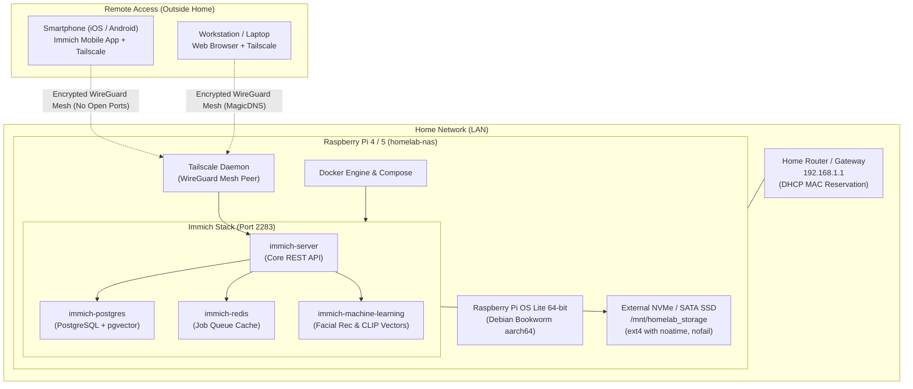
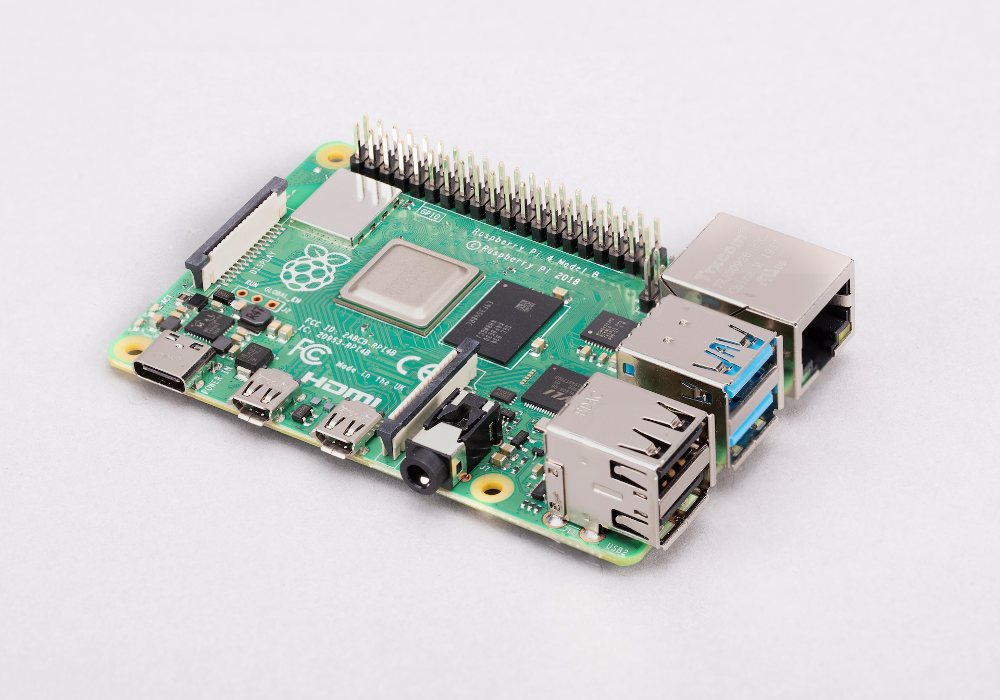
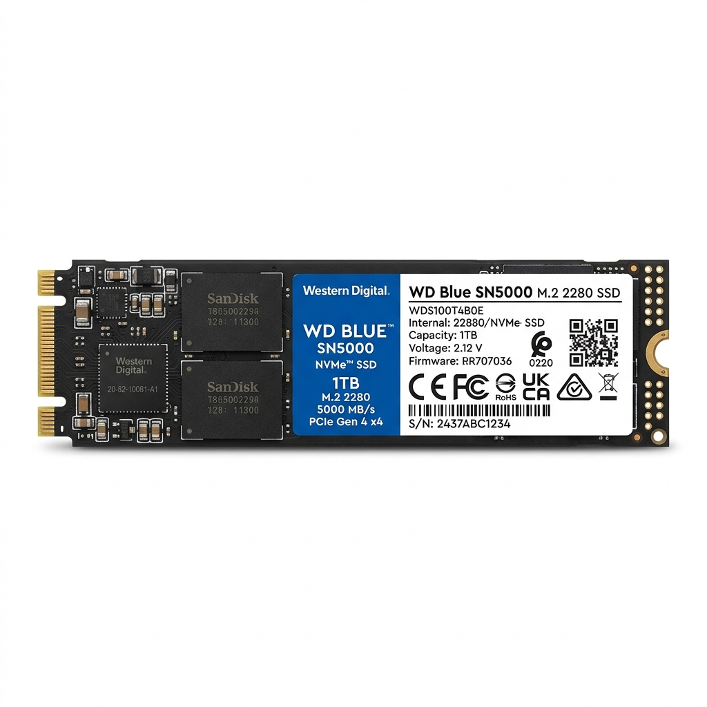
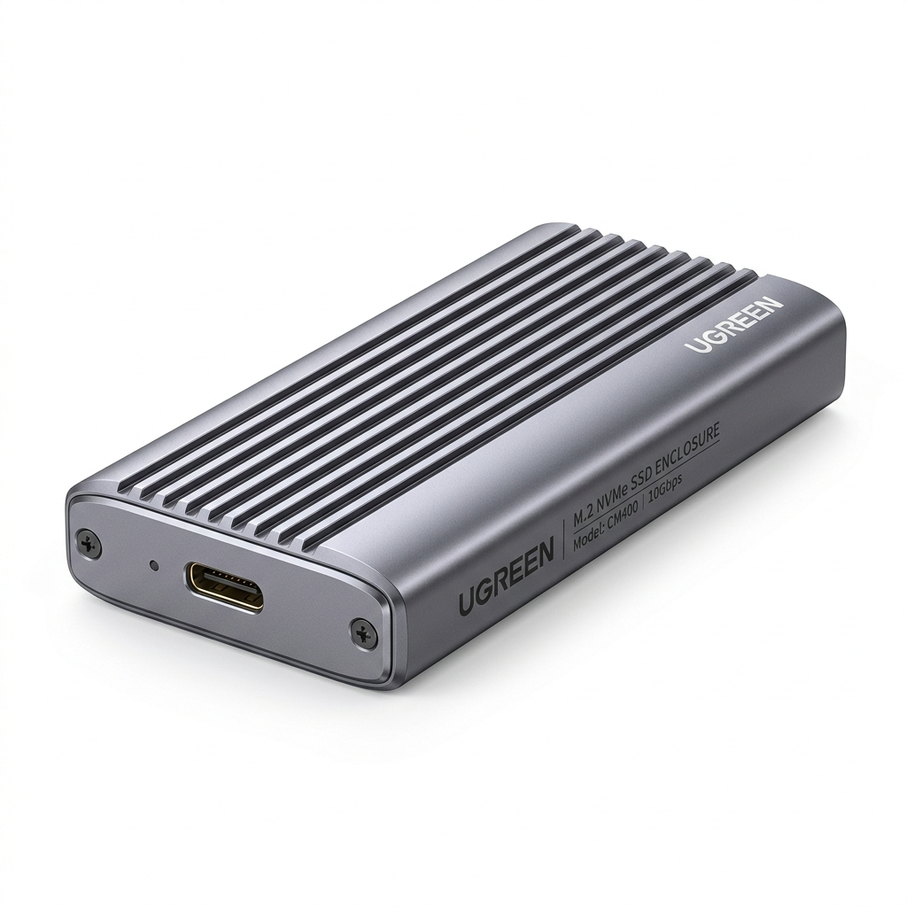
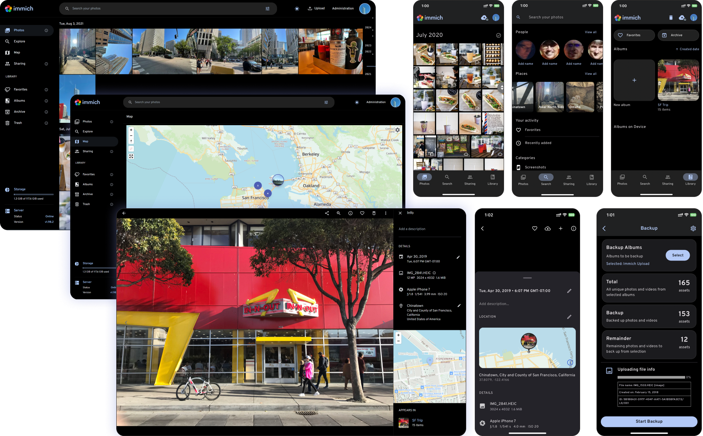

# homelab-development

> **Self-Hosted Raspberry Pi NAS & Immich Photo Cloud Guide Series**  
> *A modular, laboratory-style guide for engineering a personal Network-Attached Storage (NAS) and private photo cloud from bare metal to secure remote access.*

---

## 🧭 Laboratory Guide Overview & Roadmap

Inspired by the structured academic format of the **Purdue University ME597 (Industrial Internet of Things)** laboratory curriculum, this repository decomposes a multi-chapter homelab engineering curriculum into **3 chapters**, **18 core steps**, and **36 bite-sized, hands-on Jupyter notebooks**:
- **[Chapter 1: Raspberry Pi Immich NAS Server (`01_rpi_immich_server`)](modules/01_rpi_immich_server/README.md):** 7 steps / 16 notebooks building a 24/7 personal photo cloud from bare metal.
- **[Chapter 2: Second Node GPU Expansion (`02_second_node`)](modules/02_second_node/README.md):** 5 steps / 9 notebooks repurposing a 2019 ASUS ROG Zephyrus gaming laptop (battery removal & AC bypass, thermal refurbishment, wiping unlicensed Windows 11 for Ubuntu Server 24.04 LTS, Ubiquiti `USW-Enterprise-8-PoE` multi-gig switch networking, offloading NVIDIA CUDA Machine Learning & NVENC transcoding, and deploying Pi-hole v6 DNS & Uptime Kuma on the Raspberry Pi).
- **[Chapter 3: UniFi UNAS 2 Storage, Enterprise Networking & Personal Cloud Software (`03_unifi_nas_and_enterprise_networking`)](modules/03_unifi_nas_and_enterprise_networking/README.md):** 6 steps / 11 notebooks integrating a Ubiquiti UniFi NAS 2 (`UNAS-2`) with dual 4 TB SATA HDDs (`2× UACC-HDD-S-4TB`) in RAID 1 via its included 60W PoE++ injector, 0.4m UniFi patch cabling (`UACC-CABLE-PATCH-0.4M-BL-10`), self-hosted UniFi Network switch adoption, **University OneDrive offboarding**, **FileBrowser Quantum**, **Paperless-ngx OCR**, **Mail-Archiver** (`.edu` & Gmail preservation), automated zero-knowledge **`rclone crypt` backups into your included 5 TB Gemini Pro Google Drive**, and 10-pillar Uptime Kuma observability.

Each notebook is designed for a self-contained 20–30 minute milestone, featuring:
1. **Targeted Learning Goals** (actionable objectives)
2. **Conceptual Architecture & Background** (system diagrams and engineering trade-offs)
3. **Step-by-Step Hands-on Instructions** (terminal commands, configs, and sanity checks)
4. **📸 Inline Verification & Screenshot Submissions** (dedicated placeholder slots immediately following each milestone task)

---

### 🗺️ Chapter 1 Roadmap: Raspberry Pi Immich NAS (`01_rpi_immich_server`)

> 📖 *See the [Chapter 1 Summary & Key Learnings README](modules/01_rpi_immich_server/README.md) for a quick-reference retrospective.*

| Step | Module | Notebook Guide | Key Milestone Objective | Verification Proof |
| :---: | :--- | :--- | :--- | :--- |
| **1** | **OS Setup** | [Module 1.1: OS Selection & Prep](modules/01_rpi_immich_server/01_os_setup/01_1_os_selection_and_prep.ipynb) | Evaluate OS choices; configure 64-bit ARM image in Imager | Imager customization panel |
| **1** | **OS Setup** | [Module 1.2: Headless Flashing & Boot](modules/01_rpi_immich_server/01_os_setup/01_2_headless_flashing_and_boot.ipynb) | Flash media, verify power delivery, headless initial boot | Flashing verification & LED status |
| **1** | **OS Setup** | [Module 1.3: Post-Boot Security & Password](modules/01_rpi_immich_server/01_os_setup/01_3_post_boot_security_and_password.ipynb) | Rotate bootstrap password, verify PAM & `sudo -k` elevation | `passwd` & `sudo whoami` verification |
| **2** | **Networking** | [Module 2.1: LAN Discovery & Static IP](modules/01_rpi_immich_server/02_network_configuration/02_1_network_discovery_and_ip.ipynb) | mDNS scan, router DHCP static lease / MAC reservation | Initial ping, router DHCP table & static IP ping |
| **2** | **Networking** | [Module 2.2: Hardening SSH & Baseline](modules/01_rpi_immich_server/02_network_configuration/02_2_secure_ssh_and_baseline.ipynb) | Ed25519 key login, disable password SSH, package upgrade | SSH login banner & `htop` dashboard |
| **3** | **Storage** | [Module 3.1: SSD Hardware & Partitioning](modules/01_rpi_immich_server/03_storage_expansion/03_1_ssd_hardware_and_partitioning.ipynb) | USB 3.0 / PCIe UASP check, GPT partition, format ext4 | Hardware setup photo & `lsblk -f` partition |
| **3** | **Storage** | [Module 3.2: Persistent Mount (`fstab`)](modules/01_rpi_immich_server/03_storage_expansion/03_2_persistent_mount_fstab.ipynb) | UUID query, `/etc/fstab` `nofail` entry, reboot resilience | `df -h /mnt/homelab_storage` post-reboot |
| **4** | **Personal VPN** | [Module 4.1: VPN & Mesh Architecture](modules/01_rpi_immich_server/04_personal_vpn/04_1_vpn_architecture_tailscale.ipynb) | Understand CGNAT, WireGuard mesh vs port forwarding | Tailscale admin console setup |
| **4** | **Personal VPN** | [Module 4.2: Tailscale Node Provisioning](modules/01_rpi_immich_server/04_personal_vpn/04_2_tailscale_setup_and_verification.ipynb) | Install Tailscale, register node, end-to-end ping | `tailscale status` & client ping |
| **5** | **Docker** | [Module 5.1: Docker Engine Installation](modules/01_rpi_immich_server/05_docker_runtime/05_1_docker_engine_installation.ipynb) | Official Docker upstream repo, non-root user group | `docker run hello-world` output |
| **5** | **Docker** | [Module 5.2: Docker Compose & Homelab Layout](modules/01_rpi_immich_server/05_docker_runtime/05_2_docker_compose_and_homelab_layout.ipynb) | Compose plugin, directory tree, test container | `docker compose ps` test stack |
| **6** | **Immich NAS** | [Module 6.1: Immich Architecture & `.env`](modules/01_rpi_immich_server/06_immich_nas_deployment/06_1_immich_architecture_and_env.ipynb) | Microservices overview, Pi thread tuning, SSD path map | Custom `.env` storage mapping |
| **6** | **Immich NAS** | [Module 6.2: Compose Stack & First Boot](modules/01_rpi_immich_server/06_immich_nas_deployment/06_2_immich_compose_and_first_boot.ipynb) | Image pull, database migrations, container healthchecks | `docker compose ps` all healthy |
| **6** | **Immich NAS** | [Module 6.3: Admin Setup & Initial Library](modules/01_rpi_immich_server/06_immich_nas_deployment/06_3_immich_admin_and_photo_library.ipynb) | Admin onboarding, test photo ingest, resource profiling | Immich web UI & uploaded albums |
| **7** | **Remote Access** | [Module 7.1: Remote Access Security](modules/01_rpi_immich_server/07_remote_access/07_1_remote_access_security_and_options.ipynb) | Zero-trust threat model, Cloudflare ToS limits, MagicDNS | Web access over Tailscale FQDN |
| **7** | **Remote Access** | [Module 7.2: Mobile Sync & Maintenance](modules/01_rpi_immich_server/07_remote_access/07_2_mobile_app_sync_and_outside_testing.ipynb) | iOS/Android app config, off-network cellular sync test | Mobile app sync confirmation |

---

### 🗺️ Chapter 2 Roadmap: 2019 ROG Zephyrus GPU Node & Cluster Expansion (`02_second_node`)

> 📖 *See the [Chapter 2 Overview, Shopping List & Architecture README](modules/02_second_node/README.md) for the complete hardware repair BOM, switch topology, and hybrid workload split rationale.*

| Step | Module | Notebook Guide | Key Milestone Objective | Verification Proof |
| :---: | :--- | :--- | :--- | :--- |
| **1** | **Hardware & Battery Bypass** | [Module 1.1: Battery Removal & AC Bypass](modules/02_second_node/01_hardware_prep_and_battery_bypass/01_1_hardware_eval_and_battery_bypass.ipynb) | Safe Li-Po removal, Kapton header insulation, EC reset, UPS power bridging | Empty battery bay photo & AC-only BIOS post |
| **1** | **Hardware & Battery Bypass** | [Module 1.2: Thermal Maintenance & BIOS Prep](modules/02_second_node/01_hardware_prep_and_battery_bypass/01_2_thermal_maintenance_and_bios_prep.ipynb) | Heatsink teardown, CPU/GPU repaste, K5 Pro VRM putty, Secure Boot off | Repasted heatsink photo & BIOS settings check |
| **2** | **OS & Headless Setup** | [Module 2.1: Ubuntu Server 24.04 LTS Install](modules/02_second_node/02_os_installation_and_headless_setup/02_1_os_selection_and_ubuntu_install.ipynb) | Why Ubuntu Server beats unlicensed Windows 11; full NVMe wipe & OpenSSH | `hostnamectl`, `df -h /` & `lspci` GPU check |
| **2** | **OS & Headless Setup** | [Module 2.2: Lid-Close Mode & Power Tuning](modules/02_second_node/02_os_installation_and_headless_setup/02_2_headless_lid_close_and_power_tuning.ipynb) | `HandleLidSwitch=ignore`, `consoleblank=60`, `lm-sensors`, SSH key hardening | Closed-lid SSH session & `sensors` thermal check |
| **3** | **Lab Networking** | [Module 3.1: `USW-Enterprise-8-PoE` Topology & Static IP Plan](modules/02_second_node/03_network_expansion_and_cluster_topology/03_1_switch_topology_and_subnet_design.ipynb) | Wire `USW-Enterprise-8-PoE` (2.5GbE), reserve `10.0.0.201`, `iperf3` test & Tailscale mesh | `iperf3` ~940 Mbps & `tailscale status` |
| **4** | **GPU & Migration** | [Module 4.1: NVIDIA Drivers & Container Toolkit](modules/02_second_node/04_gpu_compute_and_workload_migration/04_1_nvidia_drivers_and_container_toolkit.ipynb) | Headless NVIDIA driver, 60W power cap service, `nvidia-ctk` & Docker Engine | `docker run --gpus all nvidia/cuda nvidia-smi` |
| **4** | **GPU & Migration** | [Module 4.2: Immich CUDA ML & NVENC Offload](modules/02_second_node/04_gpu_compute_and_workload_migration/04_2_immich_ml_and_transcoding_offload.ipynb) | Deploy `immich-machine-learning:release-cuda` on `:3003`, retire Pi ML container | Live CUDA execution in `nvidia-smi` & Pi RAM freed |
| **5** | **Pi Core Services** | [Module 5.1: Workload Split & Pi-hole v6 DNS](modules/02_second_node/05_pi_core_services/05_1_pi_workload_strategy_and_pihole.ipynb) | Why core services stay on the Pi; deploy Pi-hole v6 + Tailscale Global DNS | Pi-hole v6 admin dashboard & sinkholed query |
| **5** | **Pi Core Services** | [Module 5.2: Multi-Node Monitoring (Uptime Kuma)](modules/02_second_node/05_pi_core_services/05_2_homelab_monitoring_uptime_kuma.ipynb) | Deploy Uptime Kuma on Pi to monitor both nodes, CUDA ML `:3003`, and DNS | Uptime Kuma 100% green cluster dashboard |

---

### 🗺️ Chapter 3 Roadmap: UniFi UNAS 2 Storage, Enterprise Networking & Personal Cloud Software (`03_unifi_nas_and_enterprise_networking`)

> 📖 *See the [Chapter 3 Overview, Ubiquiti Hardware BOM, Software Port Registry & 3-2-1 Cloud Architecture README](modules/03_unifi_nas_and_enterprise_networking/README.md) for the complete PoE+ vs. PoE++ compatibility matrix, self-hosted software architecture, and 5 TB Google Drive backup design.*

| Step | Module | Notebook Guide | Key Milestone Objective | Verification Proof |
| :---: | :--- | :--- | :--- | :--- |
| **1** | **Hardware & Cabling** | [Module 1.1: UNAS 2 HDD Assembly & PoE++ Power Architecture](modules/03_unifi_nas_and_enterprise_networking/01_unifi_hardware_assembly_and_cabling/01_1_unas2_hdd_install_and_poe_architecture.ipynb) | Install 2× `UACC-HDD-S-4TB` (powered off), solve PoE+ vs. PoE++ limit via included 60W injector | Drive assembly photo & UNAS 2 LCM ready screen |
| **1** | **Hardware & Cabling** | [Module 1.2: Structured 0.4m Patch Cabling & 2.5GbE Topology](modules/03_unifi_nas_and_enterprise_networking/01_unifi_hardware_assembly_and_cabling/01_2_structured_patch_cabling_and_25gbe_topology.ipynb) | Wire shelf with `UACC-CABLE-PATCH-0.4M-BL-10`, reserve `10.0.0.202` (UNAS 2) & `10.0.0.203` (Switch) | Clean cabling photo & 4-host ping sweep |
| **2** | **UniFi Management** | [Module 2.1: Self-Hosted UniFi Network Server (`homelab-gpu`)](modules/03_unifi_nas_and_enterprise_networking/02_unifi_network_management_and_switch_adoption/02_1_self_hosted_unifi_network_server.ipynb) | Deploy `linuxserver/unifi-network-application` + pinned `mongo:7.0` on `10.0.0.201:8443` | UniFi Network UI & `docker compose ps` |
| **2** | **UniFi Management** | [Module 2.2: Adopting `USW-Enterprise-8-PoE` & PoE Hygiene](modules/03_unifi_nas_and_enterprise_networking/02_unifi_network_management_and_switch_adoption/02_2_switch_adoption_port_profiles_and_poe_hygiene.ipynb) | Adopt switch, label Ports 1–4, disable PoE on Port 4 (injector line), verify 2.5GbE telemetry | UniFi Port Manager showing 2.5GbE & PoE status |
| **3** | **NAS Storage & NFS** | [Module 3.1: UniFi Drive Onboarding, RAID 1 & Snapshots](modules/03_unifi_nas_and_enterprise_networking/03_unas2_storage_pool_and_linux_mounts/03_1_unifi_drive_raid1_and_shares.ipynb) | Build 4 TB RAID 1 Btrfs pool, create `HomelabBackups`/`MediaArchive`, schedule snapshots & NFS/SMB | UniFi Drive healthy RAID 1 pool dashboard |
| **3** | **NAS Storage & NFS** | [Module 3.2: Persistent Linux NFS Mounts & Benchmarking](modules/03_unifi_nas_and_enterprise_networking/03_unas2_storage_pool_and_linux_mounts/03_2_nfs_client_mounts_and_25gbe_benchmark.ipynb) | Mount `/var/nfs/shared/*` with `vers=3,nolock,x-systemd.automount` & benchmark sequential I/O | `df -h` NFS mounts & `dd` speed test |
| **4** | **File & Doc Mgmt** | [Module 4.1: University OneDrive Migration & FileBrowser Quantum](modules/03_unifi_nas_and_enterprise_networking/04_file_management_and_onedrive_migration/04_1_onedrive_migration_and_filebrowser.ipynb) | Migrate expiring university OneDrive (handling Entra ID blocks) & deploy FileBrowser Quantum (`:8900`) | Migrated archive stats & FileBrowser Quantum UI |
| **4** | **File & Doc Mgmt** | [Module 4.2: OCR Document Vault with Paperless-ngx](modules/03_unifi_nas_and_enterprise_networking/04_file_management_and_onedrive_migration/04_2_document_management_paperless_ngx.ipynb) | Deploy Paperless-ngx + Tika + Gotenberg (`:8000`) over `UNAS 2` NFS with 30s SMB `consume/` polling | Paperless-ngx UI showing OCR-indexed document |
| **5** | **Email Archiving** | [Module 5.1: Open-Source Email Archiving with Mail-Archiver](modules/03_unifi_nas_and_enterprise_networking/05_email_archiving_and_preservation/05_1_open_source_email_archiving_mail_archiver.ipynb) | Deploy `s1t5/mailarchiver` + `postgres:17` (`:5000`); preserve expiring `.edu` & ongoing Gmail/IMAP | Mail-Archiver UI showing synced/imported mail |
| **6** | **3-2-1 Cloud & Ops** | [Module 6.1: Local Nightly Backups & Immich External Library](modules/03_unifi_nas_and_enterprise_networking/06_tiered_backups_google_drive_and_observability/06_1_local_321_backups_and_immich_integration.ipynb) | Automate `03:00`/`03:30 AM` `pg_dump` + `rsync` from both nodes to `UNAS 2` & attach Immich library | Verified `.sql.gz` DB dumps in `/mnt/unas_backups` |
| **6** | **3-2-1 Cloud & Ops** | [Module 6.2: Encrypted 5 TB Google Drive Backups & Monitoring](modules/03_unifi_nas_and_enterprise_networking/06_tiered_backups_google_drive_and_observability/06_2_automated_5tb_google_drive_cloud_backup_and_monitoring.ipynb) | Zero-knowledge `rclone crypt` to 5 TB Google Drive (`--max-transfer 700G`), Tailscale `/32` routes & 10-pillar Kuma | Encrypted cloud sync log & 10-monitor Kuma UI |

---

## 🏗️ Homelab Architecture Overview



---

## 💻 Hardware Bill of Materials (BOM) & Selection Guidance

### 1. Single-Board Computer (SBC)
- **Raspberry Pi 5 (8GB Recommended, 4GB Minimum)**:
  - Quad-core Cortex-A76 @ 2.4GHz provides ample CPU horsepower for background thumbnail rendering, face detection, and video metadata extraction.
  - Dedicated PCIe 2.0 interface enables direct NVMe M.2 SSD connectivity via a HAT.
- **Raspberry Pi 4 Model B (8GB or 4GB)**:
  - Capable entry-level platform. Machine Learning concurrency should be throttled (`MACHINE_LEARNING_WORKERS=1`) to prevent RAM exhaustion.
  - Pi 3 or 32-bit boards are **not supported** due to Immich `pgvector` and ML runtime requirements.

### 2. Storage System
- **Solid State Drive (SSD)**: 500GB to 2TB SATA SSD or NVMe M.2 SSD.
- **Drive Enclosure / Connection**:
  - *For Pi 5*: PCIe M.2 NVMe Base HAT (e.g., Pineberry Pi HatDrive, GeeekPi, or Official Raspberry Pi M.2 HAT+).
  - *For Pi 4 or Pi 5*: USB 3.0 to 2.5" SATA / NVMe enclosure with **UASP (USB Attached SCSI Protocol)** support.
- **Boot Drive**: High-endurance Class 10 / Application Class A2 MicroSD card (e.g. SanDisk Extreme or Samsung PRO Endurance) for the base OS.

### 3. Power Supply (Crucial for Storage Stability)
- **Raspberry Pi 5**: Official 27W (5.1V / 5.0A) USB-C PD power adapter.
- **Raspberry Pi 4**: Official 15W (5.1V / 3.0A) USB-C power supply.
- *Caution*: External SSDs draw peak current during heavy write operations. An under-powered Pi will crash or corrupt disk blocks. If using a high-drain USB NVMe enclosure on a Pi 4, use an externally powered USB 3.0 hub.

### 4. Network
- **Cat 6 / Cat 5e Gigabit Ethernet Cable**: Direct connection to your router or gigabit switch. (Avoid Wi-Fi for a NAS whenever possible to ensure fast, low-latency photo uploads).

---

### 🎯 Your Selected Hardware Profile & Tuning Guide

| Component | Selected Hardware | Engineering Notes & Tuning Actions |
| :--- | :--- | :--- |
| **Compute Board** | **Raspberry Pi 4 Model B (4GB RAM)** | • Memory Tuning: Keep `MACHINE_LEARNING_WORKERS=1` in Immich `.env` to avoid out-of-memory errors.<br>• Expand Linux Swap file from 100MB to 2048MB (`/etc/dphys-swapfile`) for stability during initial photo indexing.<br>• Run headless (Raspberry Pi OS Lite 64-bit) to preserve ~3.8GB of RAM entirely for Docker containers. |
| **Drive (SSD)** | **Western Digital WD Blue SN5000 (1TB/2TB)** | • PCIe Gen 4.0 x4 M.2 2280 NVMe SSD with Western Digital nCache 4.0.<br>• DRAM-less architecture with low idle power draw, minimizing thermal throttling inside compact enclosures.<br>• Single-sided form factor fits flush into portable enclosures. |
| **Enclosure** | **UGREEN 10Gbps M.2 NVMe Enclosure** | • Connect strictly to the **blue USB 3.0 ports** (the black ports are USB 2.0 and capped at ~40MB/s).<br>• Enclosure Chipset: Realtek RTL9210 with UASP support.<br>• Aluminum grooved chassis functions as a passive heatsink for the SN5000.<br>• Power Alert: Pi 4 USB ports provide up to 1.2A (~6W) shared. Ensure the official 5.1V/3.0A power supply is used. |

#### 📸 Hardware & Reference Showcase

<p align="center">
  
  
  
</p>
<p align="center">
  <em>Figure: Raspberry Pi 4 Model B (Left), Western Digital WD Blue SN5000 (Center), and UGREEN M.2 NVMe Enclosure (Right).</em>
</p>

#### 📸 Official Immich Web & Mobile Interface Showcase

<p align="center">
  
</p>
<p align="center">
  <em>Figure: Immich Web App & Mobile Application Experience (Official Immich Documentation).</em>
</p>

---

## 💿 Operating System Recommendations & Technical Trade-offs

| Operating System | Recommendation Level | Technical Rationale |
| :--- | :---: | :--- |
| **Raspberry Pi OS Lite (64-bit)** | 🥇 **Primary Choice** | Built specifically for the Broadcom SoC. Extremely lightweight (~120MB baseline RAM), Debian stability, official firmware and video codec drivers. Headless edition contains zero GUI bloatware. |
| **Ubuntu Server 24.04 LTS (ARM64)** | 🥈 **Alternative** | Standardized Canonical release, ideal if you manage multi-node enterprise clouds or heavily use cloud-init. Slightly higher baseline memory usage (~350MB). |
| **DietPi (64-bit)** | 🥉 **Niche Alternative** | Ultra-lean RAM-logging footprint. Useful for resource-constrained systems, though custom scripts occasionally alter standard Docker directory paths. |

> ⚠️ **Always verify 64-bit (`aarch64`)**: Immich and PostgreSQL `pgvector` will fail to run on 32-bit (`armhf`) images.

---

## 📸 Progress Screenshots & Verification Evidence

All guides include structured **User Verification Screenshot Submission Boxes**. When you complete a milestone, you can paste, drag-and-drop, or link your screenshot evidence directly into your working notebook in `modules_filled/`. 

Optional: If you wish to organize your image files inside the repository, save them into the `assets/screenshots/` directory and reference them using standard Markdown:
```markdown

```

Replacing these files will automatically update the rendered previews inside each Jupyter notebook!

---

## 🚀 Getting Started

1. Open Jupyter Lab, VS Code, or Google Colab.
2. See the [Chapter 1 Summary & Learnings README](modules/01_rpi_immich_server/README.md) or navigate directly to [`modules/01_rpi_immich_server/01_os_setup/01_1_os_selection_and_prep.ipynb`](modules/01_rpi_immich_server/01_os_setup/01_1_os_selection_and_prep.ipynb).
3. Read the conceptual overview, follow the hands-on instructions, fill out your research notes, and capture your first progress screenshot!
