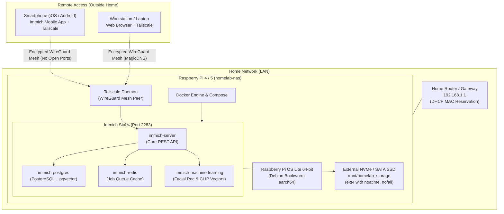
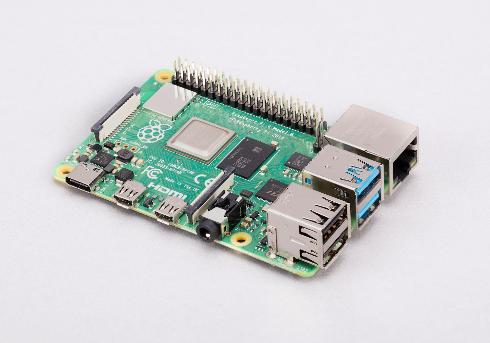
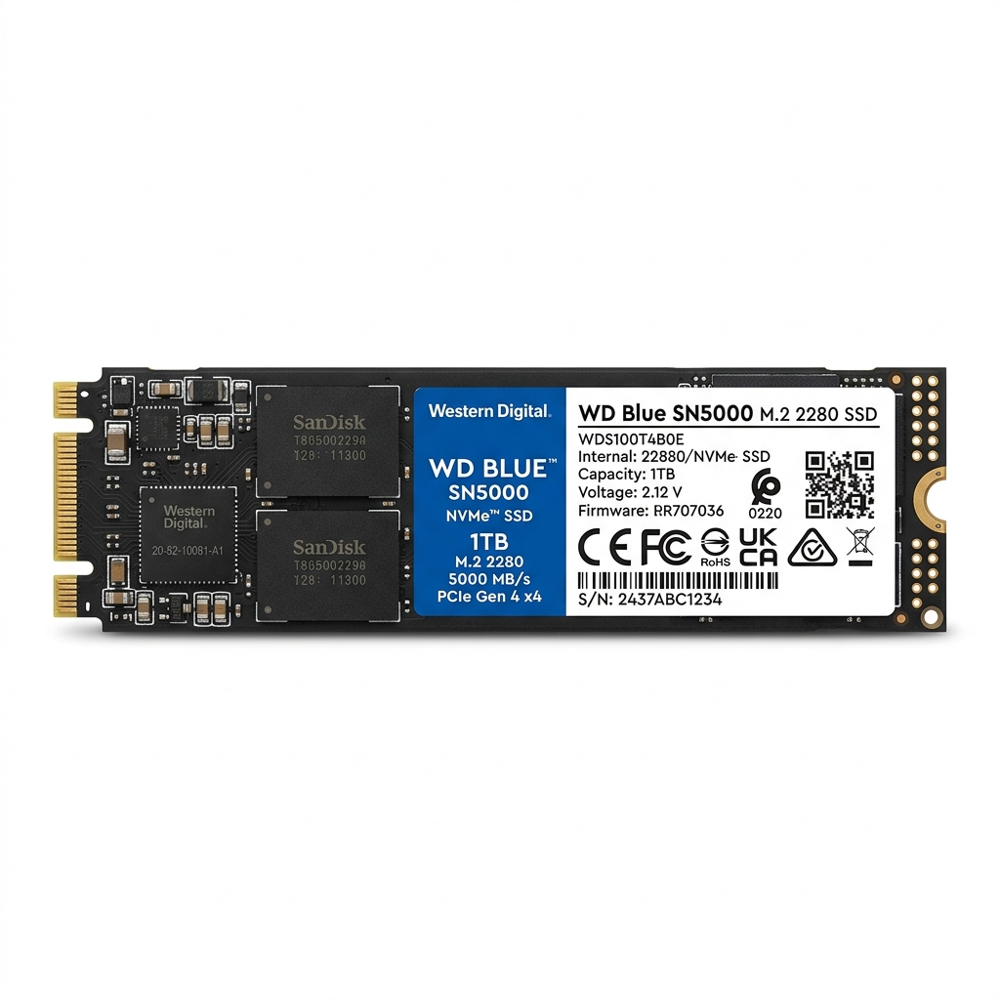
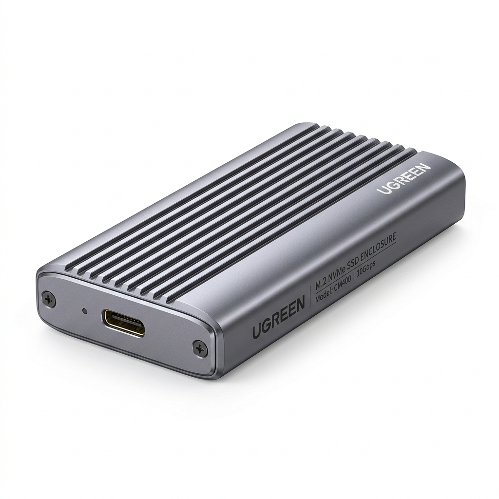
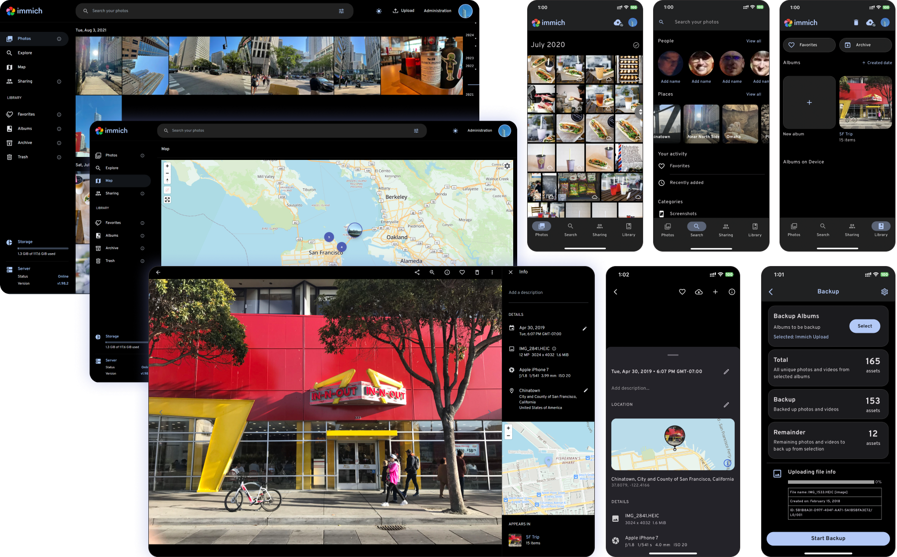

# homelab-development

> **Self-Hosted Raspberry Pi NAS & Immich Photo Cloud Guide Series**  
> *A modular, laboratory-style guide for engineering a personal Network-Attached Storage (NAS) and private photo cloud from bare metal to secure remote access.*

---

## 🧭 Laboratory Guide Overview & Roadmap

Inspired by the structured academic format of the **Purdue University ME597 (Industrial Internet of Things)** laboratory curriculum, this repository decomposes a comprehensive homelab NAS project into **7 core steps** and **16 bite-sized, hands-on Jupyter notebooks**.

Each notebook is designed for a self-contained 20–30 minute milestone, featuring:
1. **Targeted Learning Goals** (actionable objectives)
2. **Conceptual Architecture & Background** (system diagrams and engineering trade-offs)
3. **Step-by-Step Hands-on Instructions** (terminal commands, configs, and sanity checks)
4. **💡 Research & Self-Discovery Lab Space** (structured prompts with dedicated answer boxes for independent investigation)
5. **📸 Verification & Screenshot Submissions** (dedicated placeholder slots for documenting your implementation progress)

---

### 🗺️ Project Roadmap & Notebook Index

| Step | Module | Notebook Guide | Key Milestone Objective | Verification Proof |
| :---: | :--- | :--- | :--- | :--- |
| **1** | **OS Setup** | [Module 1.1: OS Selection & Prep](file:///c:/Users/rd908/Documents/WebApps/Homelab%20Development/modules/01_os_setup/01_1_os_selection_and_prep.ipynb) | Evaluate OS choices; configure 64-bit ARM image in Imager | Imager customization panel |
| **1** | **OS Setup** | [Module 1.2: Headless Flashing & Boot](file:///c:/Users/rd908/Documents/WebApps/Homelab%20Development/modules/01_os_setup/01_2_headless_flashing_and_boot.ipynb) | Flash media, verify power delivery, headless initial boot | Flashing verification & LED status |
| **1** | **OS Setup** | [Module 1.3: Post-Boot Security & Password](file:///c:/Users/rd908/Documents/WebApps/Homelab%20Development/modules/01_os_setup/01_3_post_boot_security_and_password.ipynb) | Rotate bootstrap password, verify PAM & `sudo -k` elevation | `passwd` & `sudo whoami` verification |
| **2** | **Networking** | [Module 2.1: LAN Discovery & Static IP](file:///c:/Users/rd908/Documents/WebApps/Homelab%20Development/modules/02_network_configuration/02_1_network_discovery_and_ip.ipynb) | mDNS scan, router DHCP static lease / MAC reservation | Initial ping, router DHCP table & static IP ping |
| **2** | **Networking** | [Module 2.2: Hardening SSH & Baseline](file:///c:/Users/rd908/Documents/WebApps/Homelab%20Development/modules/02_network_configuration/02_2_secure_ssh_and_baseline.ipynb) | Ed25519 key login, disable password SSH, package upgrade | SSH login banner & `htop` dashboard |
| **3** | **Storage** | [Module 3.1: SSD Hardware & Partitioning](file:///c:/Users/rd908/Documents/WebApps/Homelab%20Development/modules/03_storage_expansion/03_1_ssd_hardware_and_partitioning.ipynb) | USB 3.0 / PCIe UASP check, GPT partition, format ext4 | Hardware setup photo & `lsblk -f` partition |
| **3** | **Storage** | [Module 3.2: Persistent Mount (`fstab`)](file:///c:/Users/rd908/Documents/WebApps/Homelab%20Development/modules/03_storage_expansion/03_2_persistent_mount_fstab.ipynb) | UUID query, `/etc/fstab` `nofail` entry, reboot resilience | `df -h /mnt/homelab_storage` post-reboot |
| **4** | **Personal VPN** | [Module 4.1: VPN & Mesh Architecture](file:///c:/Users/rd908/Documents/WebApps/Homelab%20Development/modules/04_personal_vpn/04_1_vpn_architecture_tailscale.ipynb) | Understand CGNAT, WireGuard mesh vs port forwarding | Tailscale admin console setup |
| **4** | **Personal VPN** | [Module 4.2: Tailscale Node Provisioning](file:///c:/Users/rd908/Documents/WebApps/Homelab%20Development/modules/04_personal_vpn/04_2_tailscale_setup_and_verification.ipynb) | Install Tailscale, register node, end-to-end ping | `tailscale status` & client ping |
| **5** | **Docker** | [Module 5.1: Docker Engine Installation](file:///c:/Users/rd908/Documents/WebApps/Homelab%20Development/modules/05_docker_runtime/05_1_docker_engine_installation.ipynb) | Official Docker upstream repo, non-root user group | `docker run hello-world` output |
| **5** | **Docker** | [Module 5.2: Docker Compose & Homelab Layout](file:///c:/Users/rd908/Documents/WebApps/Homelab%20Development/modules/05_docker_runtime/05_2_docker_compose_and_homelab_layout.ipynb) | Compose plugin, directory tree, test container | `docker compose ps` test stack |
| **6** | **Immich NAS** | [Module 6.1: Immich Architecture & `.env`](file:///c:/Users/rd908/Documents/WebApps/Homelab%20Development/modules/06_immich_nas_deployment/06_1_immich_architecture_and_env.ipynb) | Microservices overview, Pi thread tuning, SSD path map | Custom `.env` storage mapping |
| **6** | **Immich NAS** | [Module 6.2: Compose Stack & First Boot](file:///c:/Users/rd908/Documents/WebApps/Homelab%20Development/modules/06_immich_nas_deployment/06_2_immich_compose_and_first_boot.ipynb) | Image pull, database migrations, container healthchecks | `docker compose ps` all healthy |
| **6** | **Immich NAS** | [Module 6.3: Admin Setup & Initial Library](file:///c:/Users/rd908/Documents/WebApps/Homelab%20Development/modules/06_immich_nas_deployment/06_3_immich_admin_and_photo_library.ipynb) | Admin onboarding, test photo ingest, resource profiling | Immich web UI & uploaded albums |
| **7** | **Remote Access** | [Module 7.1: Remote Access Security](file:///c:/Users/rd908/Documents/WebApps/Homelab%20Development/modules/07_remote_access/07_1_remote_access_security_and_options.ipynb) | Zero-trust threat model, Cloudflare ToS limits, MagicDNS | Web access over Tailscale FQDN |
| **7** | **Remote Access** | [Module 7.2: Mobile Sync & Maintenance](file:///c:/Users/rd908/Documents/WebApps/Homelab%20Development/modules/07_remote_access/07_2_mobile_app_sync_and_outside_testing.ipynb) | iOS/Android app config, off-network cellular sync test | Mobile app sync confirmation |

---

## 🏗️ Homelab Architecture Overview



---

## 💻 Hardware Bill of Materials (BOM) & Selection Guidance

### 1. Single-Board Computer (SBC)
- **Raspberry Pi 5 (8GB Recommended, 4GB Minimum)**:
  - Quad-core Cortex-A76 @ 2.4GHz provides ample CPU horsepower for background thumbnail rendering, face detection, and video metadata extraction.
  - Dedicated PCIe 2.0 interface enables direct NVMe M.2 SSD connectivity via a HAT.
- **Raspberry Pi 4 Model B (8GB or 4GB)**:
  - Capable entry-level platform. Machine Learning concurrency should be throttled (`MACHINE_LEARNING_WORKERS=1`) to prevent RAM exhaustion.
  - Pi 3 or 32-bit boards are **not supported** due to Immich `pgvector` and ML runtime requirements.

### 2. Storage System
- **Solid State Drive (SSD)**: 500GB to 2TB SATA SSD or NVMe M.2 SSD.
- **Drive Enclosure / Connection**:
  - *For Pi 5*: PCIe M.2 NVMe Base HAT (e.g., Pineberry Pi HatDrive, GeeekPi, or Official Raspberry Pi M.2 HAT+).
  - *For Pi 4 or Pi 5*: USB 3.0 to 2.5" SATA / NVMe enclosure with **UASP (USB Attached SCSI Protocol)** support.
- **Boot Drive**: High-endurance Class 10 / Application Class A2 MicroSD card (e.g. SanDisk Extreme or Samsung PRO Endurance) for the base OS.

### 3. Power Supply (Crucial for Storage Stability)
- **Raspberry Pi 5**: Official 27W (5.1V / 5.0A) USB-C PD power adapter.
- **Raspberry Pi 4**: Official 15W (5.1V / 3.0A) USB-C power supply.
- *Caution*: External SSDs draw peak current during heavy write operations. An under-powered Pi will crash or corrupt disk blocks. If using a high-drain USB NVMe enclosure on a Pi 4, use an externally powered USB 3.0 hub.

### 4. Network
- **Cat 6 / Cat 5e Gigabit Ethernet Cable**: Direct connection to your router or gigabit switch. (Avoid Wi-Fi for a NAS whenever possible to ensure fast, low-latency photo uploads).

---

### 🎯 Your Selected Hardware Profile & Tuning Guide

| Component | Selected Hardware | Engineering Notes & Tuning Actions |
| :--- | :--- | :--- |
| **Compute Board** | **Raspberry Pi 4 Model B (4GB RAM)** | • Memory Tuning: Keep `MACHINE_LEARNING_WORKERS=1` in Immich `.env` to avoid out-of-memory errors.<br>• Expand Linux Swap file from 100MB to 2048MB (`/etc/dphys-swapfile`) for stability during initial photo indexing.<br>• Run headless (Raspberry Pi OS Lite 64-bit) to preserve ~3.8GB of RAM entirely for Docker containers. |
| **Drive (SSD)** | **Western Digital WD Blue SN5000 (1TB/2TB)** | • PCIe Gen 4.0 x4 M.2 2280 NVMe SSD with Western Digital nCache 4.0.<br>• DRAM-less architecture with low idle power draw, minimizing thermal throttling inside compact enclosures.<br>• Single-sided form factor fits flush into portable enclosures. |
| **Enclosure** | **UGREEN 10Gbps M.2 NVMe Enclosure** | • Connect strictly to the **blue USB 3.0 ports** (the black ports are USB 2.0 and capped at ~40MB/s).<br>• Enclosure Chipset: Realtek RTL9210 with UASP support.<br>• Aluminum grooved chassis functions as a passive heatsink for the SN5000.<br>• Power Alert: Pi 4 USB ports provide up to 1.2A (~6W) shared. Ensure the official 5.1V/3.0A power supply is used. |

#### 📸 Hardware & Reference Showcase

<p align="center">
  
  
  
</p>
<p align="center">
  <em>Figure: Raspberry Pi 4 Model B (Left), Western Digital WD Blue SN5000 (Center), and UGREEN M.2 NVMe Enclosure (Right).</em>
</p>

#### 📸 Official Immich Web & Mobile Interface Showcase

<p align="center">
  
</p>
<p align="center">
  <em>Figure: Immich Web App & Mobile Application Experience (Official Immich Documentation).</em>
</p>

---

## 💿 Operating System Recommendations & Technical Trade-offs

| Operating System | Recommendation Level | Technical Rationale |
| :--- | :---: | :--- |
| **Raspberry Pi OS Lite (64-bit)** | 🥇 **Primary Choice** | Built specifically for the Broadcom SoC. Extremely lightweight (~120MB baseline RAM), Debian stability, official firmware and video codec drivers. Headless edition contains zero GUI bloatware. |
| **Ubuntu Server 24.04 LTS (ARM64)** | 🥈 **Alternative** | Standardized Canonical release, ideal if you manage multi-node enterprise clouds or heavily use cloud-init. Slightly higher baseline memory usage (~350MB). |
| **DietPi (64-bit)** | 🥉 **Niche Alternative** | Ultra-lean RAM-logging footprint. Useful for resource-constrained systems, though custom scripts occasionally alter standard Docker directory paths. |

> ⚠️ **Always verify 64-bit (`aarch64`)**: Immich and PostgreSQL `pgvector` will fail to run on 32-bit (`armhf`) images.

---

## 📸 Progress Screenshots & Verification Evidence

All guides include structured **User Verification Screenshot Submission Boxes**. When you complete a milestone, you can paste, drag-and-drop, or link your screenshot evidence directly into your working notebook in `modules_filled/`. 

Optional: If you wish to organize your image files inside the repository, save them into the `assets/screenshots/` directory and reference them using standard Markdown:
```markdown

```

Replacing these files will automatically update the rendered previews inside each Jupyter notebook!

---

## 🚀 Getting Started

1. Open Jupyter Lab, VS Code, or Google Colab.
2. Navigate to [`modules/01_os_setup/01_1_os_selection_and_prep.ipynb`](file:///c:/Users/rd908/Documents/WebApps/Homelab%20Development/modules/01_os_setup/01_1_os_selection_and_prep.ipynb).
3. Read the conceptual overview, follow the hands-on instructions, fill out your research notes, and capture your first progress screenshot!
