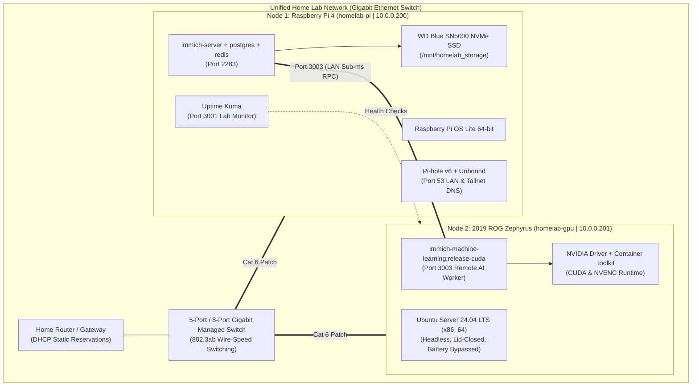

# Chapter 2: Multi-Node Homelab Expansion — Repurposing a 2019 ROG Zephyrus (`02_second_node`)

> **Hybrid ARM + x86_64/NVIDIA Homelab Architecture**  
> *Transforming a retired 2019 ASUS ROG Zephyrus gaming laptop into a battery-bypassed, 24/7 GPU compute node (`homelab-gpu`), uniting the lab with a managed Gigabit switch, offloading heavy Immich AI/CUDA workloads, and dedicating the Raspberry Pi (`homelab-pi`) to ultra-reliable network core services like Pi-hole DNS.*

---

## 🎯 Why This Move Makes Sense: The Hybrid Homelab Philosophy

In Chapter 1, our **Raspberry Pi 4 (4GB RAM)** proved that an ARM single-board computer can run a complete self-hosted cloud stack while sipping ~5W of power. However, running **everything** on a single 4GB ARM board introduces two engineering bottlenecks:
1. **Compute & Memory Pressure During Heavy Indexing:** When uploading hundreds of high-resolution photos or 4K videos to Immich, the `immich-machine-learning` container (running CLIP semantic vector embeddings and facial recognition) and FFmpeg video transcoding saturate the Pi's 4 ARM Cortex-A72 cores and push RAM near its 4GB limit—even with `MACHINE_LEARNING_WORKERS=1` and a 2GB SSD swapfile.
2. **Blast Radius (Fate Sharing):** If a heavy container spikes memory and triggers the Linux Out-Of-Memory (OOM) killer or requires a host reboot, any core network services running on that same Pi go offline simultaneously.

By introducing your **2019 ASUS ROG Zephyrus** (`GA502` / `GU502` / `GX502` series) as **Node 2 (`homelab-gpu`)**, you unlock the best of both architectures:

| Dimension | Node 1: Raspberry Pi 4 (`homelab-pi`) | Node 2: 2019 ROG Zephyrus (`homelab-gpu`) |
| :--- | :--- | :--- |
| **CPU Architecture** | 64-bit ARM (`aarch64`, 4 cores) | 64-bit x86 (`x86_64`, 6–8 cores / 12–16 threads) |
| **Memory (RAM)** | 4 GB LPDDR4 | 16 GB – 32 GB DDR4 |
| **GPU Acceleration** | VideoCore VI (no CUDA support) | **NVIDIA GeForce GTX 1660 Ti / RTX 2060 / 2070 (6GB–8GB VRAM, CUDA + NVENC)** |
| **Idle Power Draw** | ~4W – 6W | ~12W – 18W (Lid closed, dGPU in P8 idle state) |
| **Optimal Homelab Role** | **24/7 Storage & Network Core:** Primary NAS storage (`/mnt/homelab_storage`), Immich Core & PostgreSQL, **Pi-hole DNS**, Tailscale Subnet/DNS Router, Uptime Monitoring | **Heavy Compute & AI Worker:** Remote `immich-machine-learning` (`-cuda`), Hardware Video Transcoding (`NVENC`), Local LLMs (Ollama), Media Transcoding |

---

## 🏗️ Chapter 2 Multi-Node Architecture

---

## 🛒 Master Shopping List & Bill of Materials (BOM)

Before beginning the hands-on notebooks, gather the following tools, thermal consumables, and networking hardware:

### 1. Laptop Battery Removal, Bypass & Thermal Maintenance Kit
| Item | Purpose | Est. Cost |
| :--- | :--- | :--- |
| **Precision Screwdriver Set (`PH0`, `PH1` Phillips + Plastic Pry Spudgers)** | Removing the 14–15 bottom chassis screws (note varying lengths!) and unclipping the Zephyrus bottom plate without marring the magnesium-alloy/plastic clips. | \$12 – \$20 |
| **High-Viscosity Non-Conductive Thermal Paste** *(PTM7950 Phase-Change Pad, Arctic MX-6, or Noctua NT-H2)* | Repasting the bare CPU and NVIDIA GPU silicon dies. High-viscosity paste or PTM7950 prevents "pump-out" during 24/7 thermal cycling. | \$8 – \$15 |
| **Viscous Thermal Putty (`K5 PRO` or `Upsiren U6 Pro`, 20g)** | Replacing dried/torn factory VRM and GDDR6 VRAM thermal pads. Eliminates pad thickness guesswork (0.5mm vs 1.0mm) so the copper heatsink seats flush against the CPU/GPU dies. | \$12 – \$18 |
| **99% Isopropyl Alcohol (IPA) + Lint-Free Swabs & Microfiber** | Dissolving baked-on 2019 factory thermal compound and flux residue from the dies and copper heatpipes. | \$6 – \$10 |
| **Kapton Polyimide Tape (10mm) & ESD Tweezers** | Insulating the exposed motherboard battery header pins after battery removal and securing internal cables. | \$6 – \$8 |
| **Pure Sine-Wave UPS (600VA–1000VA)** *(e.g., CyberPower CP1000PFCLCD or APC BE600M1)* | **The External "Battery Bypass":** Replaces the dead internal Li-Po battery with safe, external battery backup, surge protection, and prevents abrupt Linux filesystem corruption or AC power-spike throttling during brownouts. | \$75 – \$140 |

### 2. Multi-Node Networking Expansion Kit
| Item | Purpose | Est. Cost |
| :--- | :--- | :--- |
| **8-Port Gigabit Desktop Switch** *(TP-Link TL-SG108E Smart Managed or TL-SG108 Unmanaged Metal)* | Unites `homelab-pi`, `homelab-gpu`, and your router uplink on a single non-blocking 16 Gbps backplane so node-to-node ML traffic never bottlenecks your router's Wi-Fi/CPU, leaving 5+ ports open for future nodes (NAS bay, Proxmox mini-PC, PoE AP). | \$20 – \$30 |
| **USB 3.0 / USB-C to 2.5GbE or Gigabit Ethernet Adapter** *(Only if your 2019 Zephyrus is the GA502/GU502 without a built-in RJ45 jack; GX502 has native RJ45)* | Provides a rock-solid wired Ethernet connection with Realtek RTL8153/RTL8156 Linux kernel support. | \$15 – \$22 |
| **3x Short Cat 6 Snagless Patch Cables (1 ft – 3 ft, color-coded)** | Clean, low-latency wiring from Switch $\rightarrow$ Router, Switch $\rightarrow$ `homelab-pi`, and Switch $\rightarrow$ `homelab-gpu`. | \$8 – \$12 |
| **32GB USB 3.0 Flash Drive** | Flashing the Ubuntu Server 24.04 LTS (`x86_64`) installer via Ventoy or BalenaEtcher to overwrite the unlicensed Windows 11 install. | \$7 – \$10 |

---

## 🗺️ Chapter 2 Notebook Index

| Step | Module | Notebook Guide | Key Milestone Objective | Verification Proof |
| :---: | :--- | :--- | :--- | :--- |
| **1** | **Hardware & Battery Bypass** | [Module 1.1: Hardware Evaluation, Battery Removal & AC Bypass](./01_hardware_prep_and_battery_bypass/01_1_hardware_eval_and_battery_bypass.ipynb) | Safe Li-Po removal, Kapton header insulation, EC reset, UPS power bridging | Internal battery bay photo & AC-only BIOS post |
| **1** | **Hardware & Battery Bypass** | [Module 1.2: Deep Thermal Maintenance & BIOS Server Tuning](./01_hardware_prep_and_battery_bypass/01_2_thermal_maintenance_and_bios_prep.ipynb) | Heatsink teardown, CPU/GPU repaste, K5 Pro VRM putty, Secure Boot off | Repasted heatsink photo & BIOS settings check |
| **2** | **OS & Headless Setup** | [Module 2.1: Replacing Windows 11 with Ubuntu Server 24.04 LTS](./02_os_installation_and_headless_setup/02_1_os_selection_and_ubuntu_install.ipynb) | Why Ubuntu Server 24.04 LTS beats Windows 11; full NVMe wipe & OpenSSH install | `hostnamectl` & `lsblk` on `homelab-gpu` |
| **2** | **OS & Headless Setup** | [Module 2.2: Clamshell Mode, Thermal Capping & SSH Baseline](./02_os_installation_and_headless_setup/02_2_headless_lid_close_and_power_tuning.ipynb) | `HandleLidSwitch=ignore`, console screen blanking, power limits, SSH keys | Closed-lid SSH session & `sensors` thermal check |
| **3** | **Lab Networking** | [Module 3.1: Gigabit Switch Topology & Unified Addressing](./03_network_expansion_and_cluster_topology/03_1_switch_topology_and_subnet_design.ipynb) | Wire 8-port switch, reserve `10.0.0.201`, join Tailscale mesh & SSH jump aliases | Switch wiring photo, `iperf3` & `tailscale status` |
| **4** | **GPU & Migration** | [Module 4.1: NVIDIA Drivers, Container Toolkit & Docker](./04_gpu_compute_and_workload_migration/04_1_nvidia_drivers_and_container_toolkit.ipynb) | Headless NVIDIA driver install, `nvidia-ctk`, CUDA test in Docker, `nvidia-smi` | `docker run --gpus all nvidia/cuda nvidia-smi` |
| **4** | **GPU & Migration** | [Module 4.2: Offloading Immich Machine Learning & Transcoding](./04_gpu_compute_and_workload_migration/04_2_immich_ml_and_transcoding_offload.ipynb) | Deploy `immich-machine-learning:release-cuda` on laptop, strip ML from Pi, point Pi to `:3003` | CUDA ML logs on laptop & reduced RAM on Pi |
| **5** | **Pi Core Services** | [Module 5.1: Workload Split Strategy & Pi-hole v6 DNS](./05_pi_core_services/05_1_pi_workload_strategy_and_pihole.ipynb) | What stays on the Pi & why; deploy Pi-hole v6 in Docker + Tailscale global DNS | Pi-hole v6 dashboard & blocked query log |
| **5** | **Pi Core Services** | [Module 5.2: Unified Homelab Monitoring with Uptime Kuma](./05_pi_core_services/05_2_homelab_monitoring_uptime_kuma.ipynb) | Deploy Uptime Kuma on Pi to monitor both nodes, Immich, CUDA ML port, and DNS | Uptime Kuma multi-node status dashboard |

