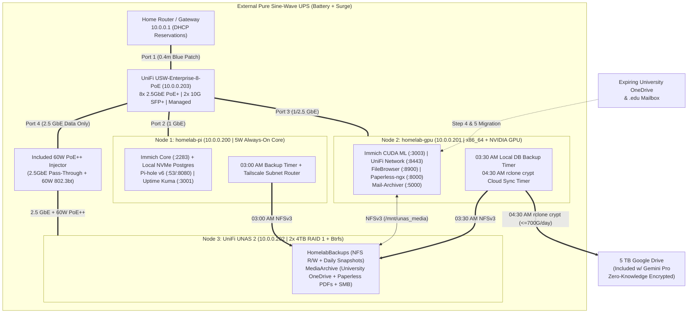
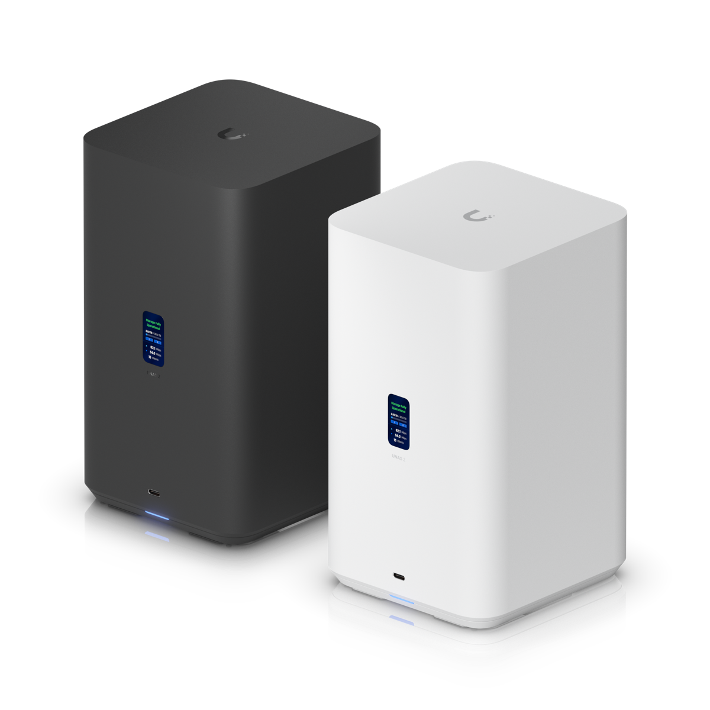
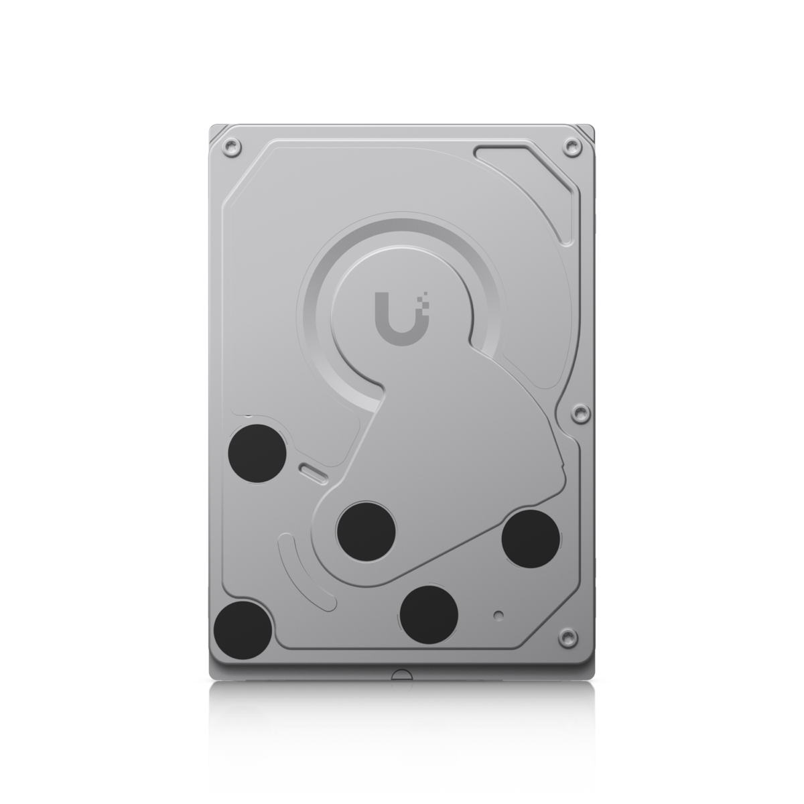
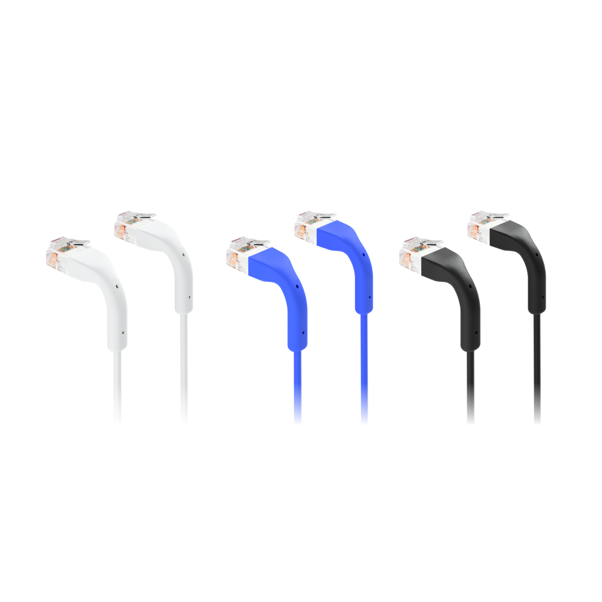
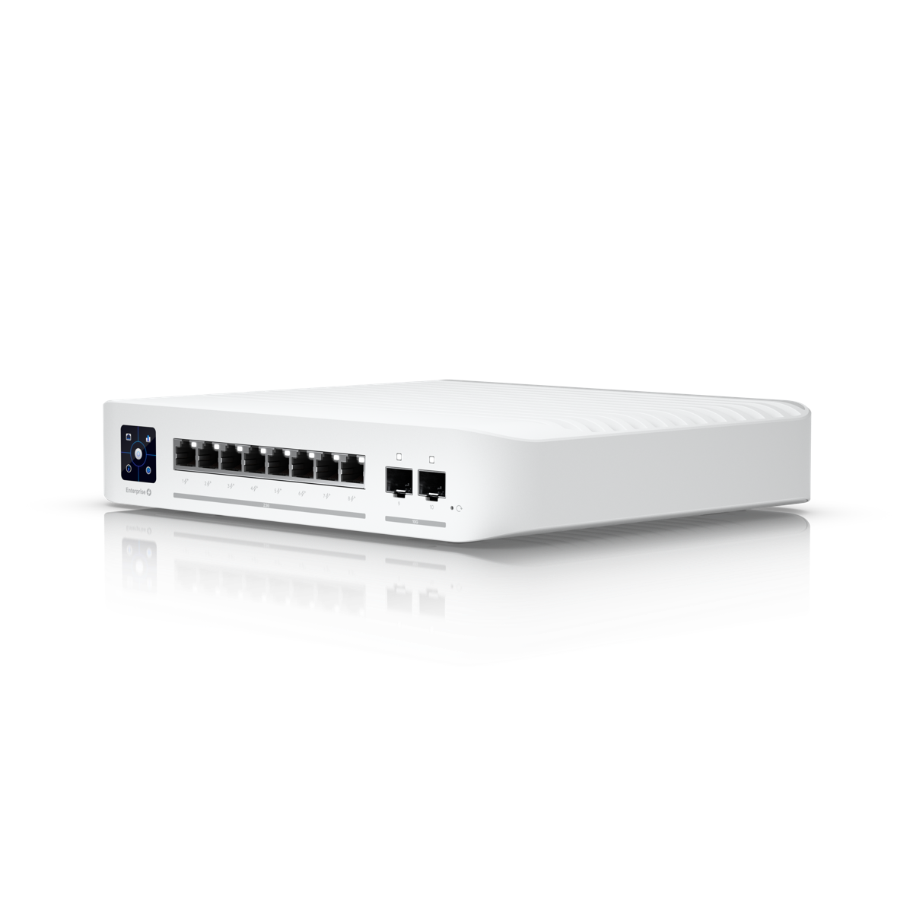

# Chapter 3: UniFi UNAS 2 Storage, Enterprise Networking & Personal Cloud Software (`03_unifi_nas_and_enterprise_networking`)

> **Tiered NVMe + RAID-1 NAS Storage, Structured 2.5GbE Patch Cabling, Self-Hosted File/Document/Email Management & Encrypted 5 TB Google Drive Cloud Backups**  
> *Integrating a Ubiquiti UniFi NAS 2 (`UNAS-2`), dual 4 TB SATA HDDs (`2× UACC-HDD-S-4TB`), ultra-thin 0.4m UniFi Patch Cables (`UACC-CABLE-PATCH-0.4M-BL-10`), and managed `USW-Enterprise-8-PoE` telemetry—then expanding the homelab software stack to migrate off an expiring university OneDrive, deploy FileBrowser Quantum, Paperless-ngx OCR, and Mail-Archiver, and automate zero-knowledge 3-2-1 offsite backups into your included 5 TB Gemini Pro Google Drive storage.*

---

## 🎯 Why This Chapter Transforms Your Homelab Into a Complete Personal Cloud

At the end of Chapter 2, your homelab combined a 5W Raspberry Pi 4 (`homelab-pi`) with an NVIDIA-accelerated 2019 ROG Zephyrus (`homelab-gpu`) across the **Ubiquiti `USW-Enterprise-8-PoE`** switch—focusing mainly on photos/videos (Immich) and core DNS/monitoring. Chapter 3 upgrades **both hardware and software** to solve four real-world post-graduation needs:

1. **Redundant On-Prem Storage (`UNAS 2` RAID 1):** Eliminates single-drive NVMe failure risk with **~3.64 TiB** of RAID-1 mirrored, Btrfs-snapshotted NAS capacity over **2.5 GbE**.
2. **Managed Enterprise Fabric (`USW-Enterprise-8-PoE` Adoption):** Deploys a self-hosted **UniFi Network Application** on `homelab-gpu:8443` for live port telemetry, PoE hygiene, and firmware control.
3. **University OneDrive & `.edu` Mailbox Offboarding + Open-Source Software Expansion:** Rescues expiring university coursework/files and `.edu` emails before account deactivation and deploys:
   - **FileBrowser Quantum (`:8900`)** — Lightweight, Google Drive/OneDrive-style web file manager directly over `UNAS 2` NFS.
   - **Paperless-ngx (`:8000`)** — Automatic OCR + Apache Tika/Gotenberg Office document vault for PDFs, `.docx`/`.xlsx`/`.pptx`, diplomas, tax docs, and receipts.
   - **Mail-Archiver (`:5000`)** — Web-searchable archive for expiring `.edu` Microsoft 365/Outlook and ongoing personal Gmail/IMAP mailboxes with attachments.
4. **Zero-Extra-Cost 3-2-1 Cloud Backups (`5 TB` Included Gemini Pro Google Drive):** Because your **~3.64 TiB RAID-1 `UNAS 2`** fits 100% inside the **5 TB Google Drive** storage included with your Gemini Pro subscription, automated nightly **`rclone crypt`** backups give you true zero-knowledge offsite disaster recovery at **\$0/month extra**!

---

## ⚠️ Critical Hardware Engineering Finding: PoE+ (`32W`) vs. PoE++ (`60W`)

| Device | IEEE PoE Standard | Max Power | Direct Switch Power Compatible? |
| :--- | :--- | :---: | :---: |
| **`USW-Enterprise-8-PoE`** (Ports 1–8 Output) | **PoE / PoE+** (`802.3af` / `802.3at`) | **32W / port** (120W total) | — |
| **`UNAS 2`** (Power Input Requirement) | **PoE++** (`802.3bt` Type 3) | **60W max** (52W drive budget) | **❌ NO — Cannot be powered directly from `USW-Enterprise-8-PoE`!** |

**The Exact Engineering Solution:** Connect `USW-Enterprise-8-PoE` **Port 4 (2.5 GbE, PoE set to Off)** via a `0.4m` UniFi Patch Cable to **`LAN In`** on the **included 60W PoE++ Adapter (Injector)** (plugged into your UPS), then run a second `0.4m` UniFi Patch Cable from **`PoE Out`** to the **`UNAS 2`**. Full **2.5 Gbps** data + dedicated **60W PoE++** power! *(Also note: `UNAS 2` drive bays are non-hot-swap—always power off before installing or removing drives.)*

---

## 🏗️ Chapter 3 Complete Hardware, Software & 3-2-1 Cloud Architecture

### Complete Service Port Registry (Zero Collisions Across All Nodes)

| Service | Host Node | Port(s) | Storage Tier Strategy |
| :--- | :---: | :---: | :--- |
| **Pi-hole v6 DNS** | `homelab-pi` (`10.0.0.200`) | `53`, `8080` | Local NVMe (backed up nightly to `UNAS 2`) |
| **Immich Core & Postgres** | `homelab-pi` (`10.0.0.200`) | `2283` | Local NVMe DB/Uploads + optional R/O `UNAS 2` External Library |
| **Uptime Kuma (10 Monitors)** | `homelab-pi` (`10.0.0.200`) | `3001` | Local NVMe (backed up nightly to `UNAS 2`) |
| **Immich CUDA ML Worker** | `homelab-gpu` (`10.0.0.201`) | `3003` | Local GPU VRAM / model cache |
| **Mail-Archiver (`.edu` + Gmail)** | `homelab-gpu` (`10.0.0.201`) | `5000` | Local NVMe Postgres 17 (dumped nightly to `UNAS 2`) |
| **Paperless-ngx (OCR + Tika)** | `homelab-gpu` (`10.0.0.201`) | `8000` | Local NVMe Postgres 17 + **`UNAS 2` RAID 1** `media/` & `consume/` |
| **UniFi Network Application** | `homelab-gpu` (`10.0.0.201`) | `8443`, `8080`, `3478/udp`, `10001/udp` | Local NVMe pinned `mongo:7.0` (`.unf` backups synced to `UNAS 2`) |
| **FileBrowser Quantum** | `homelab-gpu` (`10.0.0.201`) | `8900` | Directly serves **`UNAS 2` RAID 1** (`/mnt/unas_media`) |
| **UniFi OS / UniFi Drive** | `homelab-nas` (`10.0.0.202`) | `443`, `2049` (NFS), `445` (SMB) | **2× 4 TB `UACC-HDD-S-4TB` RAID 1 + Btrfs Snapshots** |
| **Managed Core Switch** | `homelab-sw` (`10.0.0.203`) | Managed by `10.0.0.201:8080` | Adopted into UniFi Network Application |

---

## 📦 Chapter 3 Hardware Bill of Materials (BOM)

| Component | Exact SKU / Model | Key Verified Specifications |
| :--- | :--- | :--- |
| **2-Bay Desktop NAS** | **UniFi NAS 2 (`UNAS-2`)** | Quad-core ARM Cortex-A55 @ 1.7 GHz, 4 GB RAM, 2× 3.5" SATA bays (non-hot-swap), 1× 2.5 GbE RJ45, 1× 5 Gbps USB-C front port, 1.47" LCM screen, UniFi OS / UniFi Drive (Btrfs + RAID 1), PoE++ (60W max, **60W PoE++ adapter included**). |
| **Dual NAS Hard Drives (2×)** | **2× UniFi Basic Capacity 3.5" HDD, 4 TB (`UACC-HDD-S-4TB`)** | 3.5" SATA 6 Gb/s, 5400 RPM, 180 TB/year workload rating, 1,000,000-hr MTBF. Deployed in **RAID 1** (~3.64 TiB usable). |
| **Structured Patch Cables** | **UniFi Patch Cable 10-Pack (`UACC-CABLE-PATCH-0.4M-BL-10`)** | 10× 0.4 m (1.3 ft) Blue ultra-thin 2.5 mm TPE jacket, 34 AWG copper, ±90°/±45° bendable boots, rated up to **10 GbE** and **PoE+++**. |
| **Managed Multi-Gig Switch** | **UniFi Switch Enterprise 8 PoE (`USW-Enterprise-8-PoE`)** *(Installed in Ch. 2, Adopted Here)* | 8× 2.5 GbE PoE+ (802.3af/at, 120W total / 32W max per port), 2× 10G SFP+, 80 Gbps switching capacity, fanless passive cooling, 1.3" LCM touchscreen. |
| **Offsite Cloud Quota** | **Google Drive 5 TB (Included w/ Gemini Pro Subscription)** | Holds 100% of `UNAS 2` (~3.64 TiB) encrypted client-side via `rclone crypt` with >1.3 TB headroom at **\$0 additional storage cost**. |

#### 📸 Chapter 3 Ubiquiti Hardware Showcase

  
  
  
  

  <em>Figure: UniFi UNAS 2 (Left), 2× UACC-HDD-S-4TB 4TB HDDs (Center-Left), UACC-CABLE-PATCH-0.4M-BL-10 Cables (Center-Right), and USW-Enterprise-8-PoE Switch (Right).</em>

---

## 🗺️ Chapter 3 Notebook Index (6 Steps / 11 Notebooks)

| Step | Module | Notebook Guide | Key Milestone Objective | Verification Proof |
| :---: | :--- | :--- | :--- | :--- |
| **1** | **Hardware & Cabling** | [Module 1.1: UNAS 2 HDD Assembly & PoE++ Power Architecture](./01_unifi_hardware_assembly_and_cabling/01_1_unas2_hdd_install_and_poe_architecture.ipynb) | Install 2× `UACC-HDD-S-4TB` (powered off!), solve PoE+ vs. PoE++ limit via included 60W injector | Drive assembly photo & UNAS 2 LCM boot screen |
| **1** | **Hardware & Cabling** | [Module 1.2: Structured 0.4m Patch Cabling & 2.5GbE Topology](./01_unifi_hardware_assembly_and_cabling/01_2_structured_patch_cabling_and_25gbe_topology.ipynb) | Wire shelf with `UACC-CABLE-PATCH-0.4M-BL-10`, reserve `10.0.0.202` (UNAS 2) & `10.0.0.203` (Switch) | Clean cabling photo & 4-host ping sweep |
| **2** | **UniFi Management** | [Module 2.1: Self-Hosted UniFi Network Server (`homelab-gpu`)](./02_unifi_network_management_and_switch_adoption/02_1_self_hosted_unifi_network_server.ipynb) | Deploy `linuxserver/unifi-network-application` + pinned `mongo:7.0` on `10.0.0.201:8443` | UniFi Network dashboard & `docker compose ps` |
| **2** | **UniFi Management** | [Module 2.2: Adopting `USW-Enterprise-8-PoE` & PoE Hygiene](./02_unifi_network_management_and_switch_adoption/02_2_switch_adoption_port_profiles_and_poe_hygiene.ipynb) | Adopt switch (`10.0.0.203`), label Ports 1–4, set PoE = Off on Port 4 (injector line), verify 2.5GbE | Adopted UniFi Port Manager & 2.5GbE telemetry |
| **3** | **NAS Storage & NFS** | [Module 3.1: UniFi Drive Onboarding, RAID 1 & Btrfs Snapshots](./03_unas2_storage_pool_and_linux_mounts/03_1_unifi_drive_raid1_and_shares.ipynb) | Build 4 TB RAID 1 Btrfs pool, create `HomelabBackups`/`MediaArchive`, schedule snapshots & NFS/SMB | UniFi Drive healthy RAID 1 pool dashboard |
| **3** | **NAS Storage & NFS** | [Module 3.2: Persistent Linux NFS Mounts & 2.5GbE Benchmark](./03_unas2_storage_pool_and_linux_mounts/03_2_nfs_client_mounts_and_25gbe_benchmark.ipynb) | Mount `/var/nfs/shared/*` with `vers=3,nolock,x-systemd.automount` & benchmark sequential I/O | `df -h` NFS mounts & `dd` speed test |
| **4** | **File & Doc Mgmt** | [Module 4.1: University OneDrive Migration & FileBrowser Quantum](./04_file_management_and_onedrive_migration/04_1_onedrive_migration_and_filebrowser.ipynb) | Migrate expiring university OneDrive (handling Entra ID blocks) & deploy FileBrowser Quantum (`:8900`) | Migrated archive stats & FileBrowser Quantum UI |
| **4** | **File & Doc Mgmt** | [Module 4.2: OCR Document Vault with Paperless-ngx](./04_file_management_and_onedrive_migration/04_2_document_management_paperless_ngx.ipynb) | Deploy Paperless-ngx + Tika + Gotenberg (`:8000`) over `UNAS 2` NFS with 30s SMB `consume/` polling | Paperless-ngx UI showing OCR-indexed document |
| **5** | **Email Archiving** | [Module 5.1: Open-Source Email Archiving with Mail-Archiver](./05_email_archiving_and_preservation/05_1_open_source_email_archiving_mail_archiver.ipynb) | Deploy `s1t5/mailarchiver` + `postgres:17` (`:5000`); preserve expiring `.edu` & ongoing Gmail/IMAP | Mail-Archiver UI showing synced/imported mail |
| **6** | **3-2-1 Cloud & Ops** | [Module 6.1: Local Nightly Backups & Immich External Library](./06_tiered_backups_google_drive_and_observability/06_1_local_321_backups_and_immich_integration.ipynb) | Automate `03:00`/`03:30 AM` `pg_dump` + `rsync` from both nodes to `UNAS 2` & attach Immich library | Verified `.sql.gz` DB dumps in `/mnt/unas_backups` |
| **6** | **3-2-1 Cloud & Ops** | [Module 6.2: Encrypted 5 TB Google Drive Backups & Monitoring](./06_tiered_backups_google_drive_and_observability/06_2_automated_5tb_google_drive_cloud_backup_and_monitoring.ipynb) | Zero-knowledge `rclone crypt` to 5 TB Google Drive (`--max-transfer 700G`), Tailscale `/32` routes & 10-pillar Kuma | Encrypted cloud sync log & 10-monitor Kuma UI |
